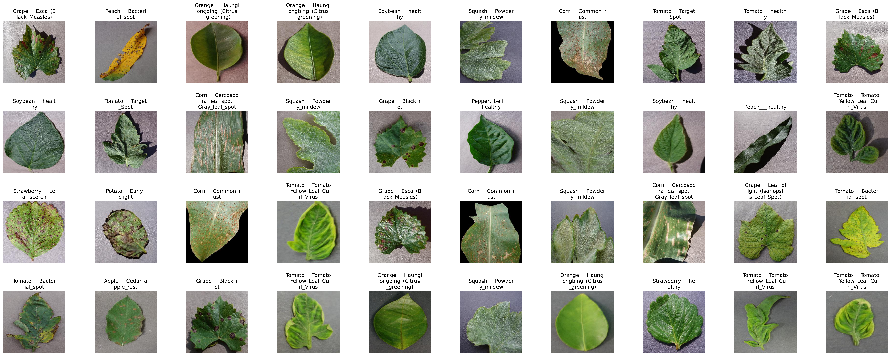
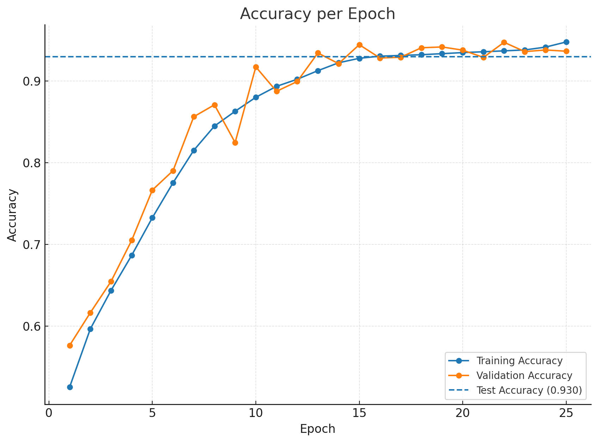
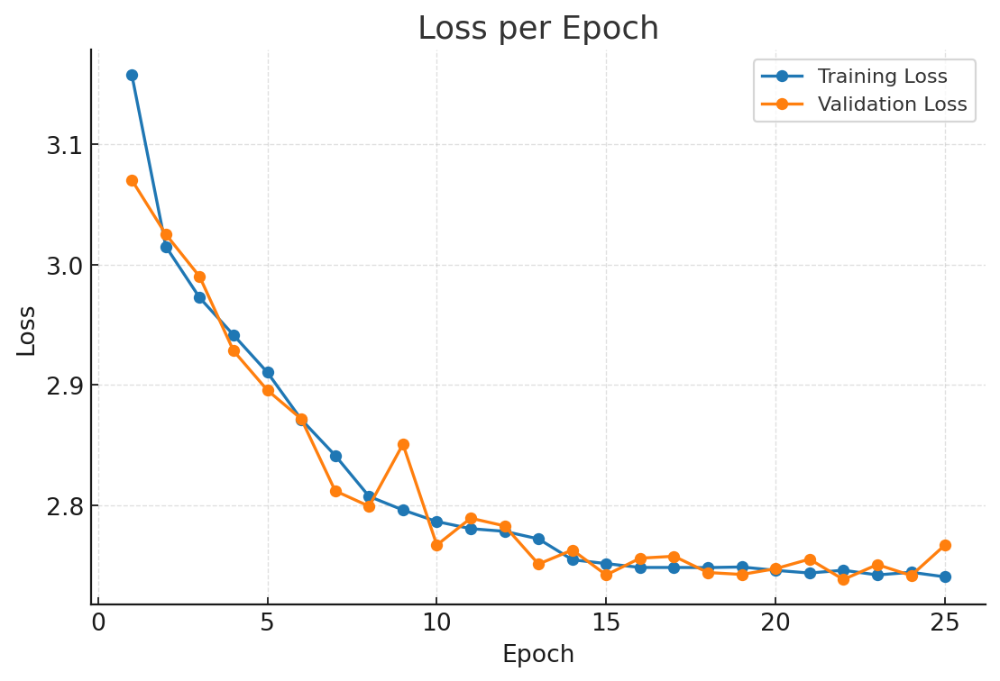

# PlantAi — Plant Disease Detection (Model Training)

PlantAi is a CNN trained on PlantVillage to classify leaf images as healthy or diseased. This repository provides PyTorch training code and export tools (ONNX / TorchScript / TFLite) for deployment.

<p align="center">
  
</p>


## Overview

* **Training-first:** Config-driven PyTorch pipeline (dataloader, augmentation, logging, plotting).
* **Exports:** ONNX / TorchScript / TFLite for downstream deployment.
* **Lightweight inference:** Designed for CPU-friendly inference after export.

---

## Requirements & Installation

```bash
# from repo root
pip install -r requirements.txt
```

> Python 3.9+ recommended. Use a virtualenv/conda if preferred.

---

## Training (PyTorch)

1. **Dataset placement**
   Download **PlantVillage** and place under `model/data/<DATASET_NAME>/` in class‑subfolders (ImageFolder layout).

   * GitHub: [https://github.com/spMohanty/PlantVillage-Dataset](https://github.com/spMohanty/PlantVillage-Dataset)
   * Kaggle: [https://www.kaggle.com/datasets/nishantvalvi1504/plantvillagecomplete](https://www.kaggle.com/datasets/nishantvalvi1504/plantvillagecomplete)

2. **Config**
   Edit `model/config/plantai_resnet_18.yaml`:

   * `DATASET.PATH: model/data`
   * `DATASET.NAME: <DATASET_NAME>`
   * `OUTPUT_DIR: log/plant_ai_resnet18` (or your choice)

3. **Run**

```bash
cd model
python train.py --config_file config/plantai_resnet_18.yaml
```

Checkpoints/plots are written under `model/log/...`.

---

## Model Export

> Ensure `MODEL.WEIGHTS` in the YAML points to your trained `best_model.pth`.

```bash
cd model

# ONNX
python export/export_to_onnx.py --config_file config/plantai_resnet_18.yaml

# TorchScript (Lite)
python export/export_to_torchscript.py --config_file config/plantai_resnet_18.yaml

# TensorFlow Lite
python export/export_to_tf_light.py --config_file config/plantai_resnet_18.yaml --output plantai_model.tflite
```

---

## Dataset (PlantVillage)

* \~**54,305** images of healthy/diseased leaves captured on plain backgrounds.
* **38 classes** total (**26 diseases + healthy** across common crops).
* \~**17 crop** types (e.g., apple, grape, corn, tomato, potato, pepper, etc.).
* Public, widely used for supervised learning; ideal for compact models and mobile inference.

**Source:** [https://github.com/spMohanty/PlantVillage-Dataset](https://github.com/spMohanty/PlantVillage-Dataset)

**Sample grid**


---

## Results (training snapshots)

<div align="center">
  
  
</div>

### Evaluation (test set)

- **Accuracy:** 93.14%  
- **Precision (weighted):** 92.90%  
- **Recall (weighted):** 93.14%
- **F1 Score (weighted):** 92.50%

## Pretrained Weights
**ResNet-18 (PlantVillage)** — [Download weights](https://drive.google.com/file/d/16qjReeJRNAE50sg4UgcE3WOIiRi1EcPJ/view?usp=sharing)

---

## Acknowledgments

* Dataset: **PlantVillage** — [https://github.com/spMohanty/PlantVillage-Dataset](https://github.com/spMohanty/PlantVillage-Dataset)
